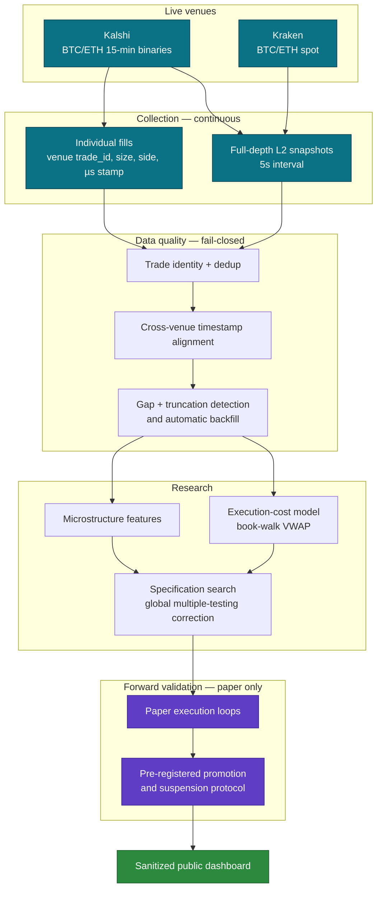

# Prediction Market Execution Lab

Research infrastructure for high-frequency prediction markets and crypto
microstructure. Continuously collects full-depth order books and individual
fills from Kalshi (BTC/ETH 15-minute binaries) and Kraken (BTC/ETH spot), aligns
the two venues on a common clock, models execution cost by walking the book, and
runs candidate strategies forward in paper simulation under a pre-registered
promotion protocol.

**Everything here is paper trading.** No real orders are placed. Where results
are shown they are simulated executions against recorded books, and they are
labelled as such.

---

## What this project studies

Kalshi's short-horizon crypto contracts settle on whether an asset is above a
strike at a fixed expiry, so they are a direct, tradeable probability on a
quantity that also trades continuously on a spot venue. That makes them a clean
laboratory for questions that are hard to isolate elsewhere:

- **Does the prediction market lag the spot book, and by how long?** Both venues
  are recorded at 5-second resolution, so the lead-lag relationship can be
  measured rather than assumed.
- **What does it actually cost to trade a thin binary?** Depth is shallow and the
  edge per contract is cents, so execution cost is not a second-order correction
  — it frequently determines the sign of a strategy.
- **How much of an apparent edge survives multiple-testing discipline?** With
  thousands of specifications searched, the interesting question is not whether
  something looks profitable but whether anything survives a global correction.

On that last question the honest answer so far is *no* for BTC, and that result
is reported here as prominently as anything else.

---

## System architecture



Teal is live recorded data, purple is simulated paper execution, green is the
public surface. Nothing crosses from paper into a live order path.

---

## Selected results

Research pass 2026-10-22, organised by question. The full evidence, with
confidence intervals, is on the dashboard.

**1. Historical edge did not survive prospective testing.**
Six candidates passed nested walk-forward out-of-fold testing and were then
run forward on unseen markets from zero-start paper ledgers: 5,927 simulated
trades at walked 10-contract VWAP plus Kalshi fees, held to settlement. In
research they averaged **+2.1 percentage points** of win rate above their
break-even `w* = p + f/q`. Forward, the pooled margin is **−0.06 pp**
(95% CI −0.87 to +0.74 pp). None of the six has a forward confidence interval
above zero, and four have been retired or have triggered the frozen suspension
rule on their own forward evidence. The gap between the two numbers is the cost
of selecting from ~21,000 specifications, measured prospectively rather than
assumed.

**2. The binary's price is a better forecaster than the spot-implied model.**
Most of the failed candidates traded the gap between the Kalshi price and a
barrier probability implied by Kraken spot, strike, time to expiry and trailing
volatility. On 7,696 prospective entries, out of sample, the model's Brier
score is worse than the Kalshi mid's by 0.022 (BTC) and 0.008 (ETH), both CIs
above zero. Given the mid, the model's logistic coefficient is indistinguishable
from zero (z = 0.13 / 0.21). The "mispricing" was mostly model error.

**3. Execution cost decides the sign, not the margin.**
Across every forward trade, the settlement edge measured from the mid was
+$533. Crossing the spread and walking the book cost $292, and exchange fees
$645, leaving −$403. Fees alone exceed the total edge.
`src/execution/orderbook_vwap.py` is the book-walk model used to make that call.

**4. The binary reprices with spot inside the same seconds, so speed alone is not an edge.**
On a fresh 10-day public tick sample (27M Kalshi prints, 1.5k contracts), Kalshi
has already priced 63% of the model-implied change by the end of a three-sigma
five-second Kraken move, and about 74% a minute later. All 22 rules preregistered
before the sample was read lose or are insignificant after correction (reality-check
p = 0.39): spot-jump following at 1–5 s latency, signed-flow following, and
largest model-vs-mid gaps. Every latency rule loses about 2¢ per contract once
the fee is paid. One lead is recorded for a future test: aggressive taker flow
is contrarian for settlement on both assets. It does not survive correction
across the 32 flow regressions.

**5. Infrastructure large enough to test on.**
3.51M synchronized 5-second cross-venue observations and 181 engineered
features (120-day, 11,290-contract BTC panel plus ETH), 5,136 high-frequency
specifications across seven pre-registered cycles, and a global reality-check
p-value of 1.00 (BTC) / 0.997 (ETH) on the latest cycle.

No result here is a claim of profitability. The strongest surviving candidate
(BTC, +$52.61 over 371 paper trades, CI touching zero) is attenuating on unseen
data and is reported as an experiment in progress.

---

## Technical highlights

- **Continuous full-depth collection.** 5-second L2 snapshots plus individual
  fills for both assets on both venues, running unattended.
- **Exact trade identity.** Fills carry the venue's own `trade_id`. Deduplicating
  instead on `(instrument, timestamp, price, size, side)` — which looks unique
  and is not — destroys ~7–9% of real fills; measured, not assumed.
- **Fail-closed validation.** A collection run that fetches successfully but
  persists nothing fails the pipeline. "The job ran" and "the data arrived" are
  separate claims and only the second is asserted.
- **Automatic gap recovery.** Missing or truncated days are detected against
  both volume and timestamp-span baselines and refetched inside the venue's
  retention window, so an infrastructure outage is recoverable rather than
  permanent data loss.
- **No-lookahead cross-venue alignment.** Backward-only as-of joins with an
  explicit staleness tolerance; an observation is never matched to reference
  data recorded after it.
- **Pre-registered forward governance.** Hypothesis catalogues are hashed and
  frozen before evaluation, so the promotion decision cannot be rewritten after
  seeing the outcome.

---

## Example code

Purpose-built public implementations of the techniques above. They demonstrate
the method without carrying any strategy parameters.

| module | what it does |
|---|---|
| [`src/execution/orderbook_vwap.py`](src/execution/orderbook_vwap.py) | Walks a limit order book to compute realised VWAP, slippage against the touch, fill fraction and the market-impact curve. Reports partial fills rather than silently completing them. |
| [`src/examples/align_market_data.py`](src/examples/align_market_data.py) | Backward-only as-of alignment of two asynchronous venue streams, with a bounded staleness tolerance and a match-quality report. Includes collection-gap detection. |
| [`src/validation/collection_validation.py`](src/validation/collection_validation.py) | Fail-closed validation of a collected trade file: existence, schema, unique non-null identity, instrument consistency, freshness. Plus dual-signal truncation detection. |

```bash
pip install pandas pytest && python -m pytest tests/ -q     # 37 tests
```

---

## Dashboard

**https://borto3019.github.io/prediction-market-execution-lab/**

Organised around five research questions:
- does historical edge survive prospective testing?
- is the binary mispriced against a spot model?
- how fast does it absorb spot moves?
- does order flow predict?
- where does the edge go?

It also carries the live status of the frozen paper candidates. It shows every
forward-tested candidate's equity curve, not only the best. Historical
out-of-fold and prospective forward phases are drawn separately and never
joined. Candidates retired by the suspension policy appear de-identified.

Sanitized: aggregates only. No strategy conditions, thresholds, entry side or
entry window, no raw data.

---

## Methodology and honesty notes

Being explicit about what each number is:

- **Live-collected** — order books and fills. Recorded continuously from public
  venue APIs.
- **Simulated execution** — every fill price shown. Orders are walked against the
  book that was standing at decision time. No real orders have been placed.
- **Paper-forward** — six frozen candidates run prospectively from zero-start
  ledgers (two still running as experimental shadows). Still simulation, not money.
- **Public tick sample** — 10 days of Kalshi prints and Kraken prints collected
  for the 2026-10-22 pass. There the entry price is the first observed print on
  the traded side after a stated reaction latency; depth is not observed.
- **Historical / in-sample** — the specification search. Explicitly not evidence
  of edge; it is the input to the multiple-testing correction, not the output.

No claim is made that this system has demonstrated alpha. The pooled forward
result across all six frozen candidates is a null. The latest pre-registered
mechanism search (four new families, each guaranteed exercisable by a blind
base-rate gate, on a fresh 8-day window) rejected all four on both assets below
break-even. The 2026-10-22 pass added an independent public tick sample and
preregistered 22 executable rules before seeing it; results are on the dashboard.

---

## Repository boundary

This is a curated public subset of a larger private research system. It contains
documentation, generic implementations of the techniques, sanitized aggregate
results and the public dashboard.

It deliberately excludes raw market data, collector infrastructure, strategy
logic and parameters, candidate-generation internals, governance records and all
credentials. Nothing here can reach the private system: publication is one-way.

Every file is allowlisted, sanitized, secret-scanned and hash-manifested before
it is published.

---

## Author

**Andrea Bortolini** — UCLA Anderson MFE
Quantitative trading · market microstructure · prediction markets

---

*Paper trading only. Nothing here is investment advice or an offer to trade.*
